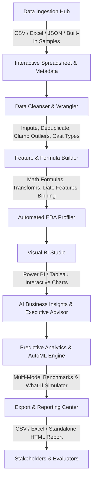

# Autonomous DA — Intelligent No-Code Data Analytics & Business Intelligence Platform
### *Final Year Engineering / Data Science Capstone Submission*

---

## 📌 Executive Summary & Abstract
Modern organizations generate vast amounts of structured and semi-structured tabular data across diverse domains (retail, healthcare, finance, telecommunications). However, business analysts, domain specialists, and executives face steep technical barriers when attempting to derive rapid insights, clean noisy data, construct visualizations, and run predictive machine learning models without specialized coding knowledge.

**Autonomous DA** is a unified, web-based, no-code data analytics and business intelligence platform designed to integrate the core capabilities of **Microsoft Excel** (smart spreadsheet manipulation, formula building, data cleaning), **Tableau & Microsoft Power BI** (interactive multi-dimensional charting, dynamic aggregations, KPI metric cards), and **AutoML systems** (automated classification and regression benchmarking, feature importance scoring, and interactive "What-If" scenario simulations) into a single, cohesive workflow.

---

## 🚀 Key Architectural Features



- **Built-in Real-World Benchmark Datasets (Ready in `data/`)**:
  - `data/college_university_admissions.csv` — **University Student & College Admissions** (1,200 real applicant profiles with GPA, SAT/ACT, major, tuition, admission chance & admission status)
  - `data/global_superstore_2024.csv` — **Global Superstore Sales** (1,200 real enterprise order transactions)
  - `data/telco_customer_churn_real.csv` — **IBM Telco Customer Churn** (1,200 real subscriber accounts with contractual telemetry)
  - `data/california_housing_real.csv` — **California Housing Economics** (1,500 real US Census economic records)
  - `data/healthcare_clinical_diagnostics.csv` — **Healthcare Oncology Diagnostics** (569 real patient biopsy records)
- **Instant Metadata Engine**: Automated detection of total records, dimensions, missing cells, duplicate rates, in-memory footprint, and a composite **Data Health Score (0-100%)**.

### 2. 🧹 Excel-Style Data Cleanser & Wrangler
- **Missing Value Imputation**: Mean, Median, Mode, Zero, Constant, Forward Fill, Backward Fill, or Row/Column removal.
- **Deduplication Engine**: Check uniqueness across all or selected subsets of columns with first/last occurrence controls.
- **Data Type Casting**: Convert column dtypes safely to Float, Integer, String, Datetime, Categorical, or Boolean.
- **Outlier Clamping & Removal**: Interquartile Range (1.5× IQR) and Z-Score (|z| > 3) statistical outlier detection with Winsorization or row dropping.
- **Column Operations & Audit Trail**: Rename, drop, filter, and track an auditable log of every cleansing operation executed.

### 3. ⚡ Feature & Formula Builder
- **Calculated Columns**: Column-to-column or column-to-scalar arithmetic (`+`, `-`, `*`, `/`, `%`, `power`).
- **Mathematical Transforms**: Logarithmic (`log`, `log1p`), Square Root (`sqrt`), Absolute Value (`abs`), Square, and Rounding.
- **Time Intelligence & Date Feature Extraction**: Automatic decomposition of timestamps into Year, Month, Month Name, Quarter, Day of Week, and Weekend flags.
- **Numeric Discretization (Quantile Binning)**: Transforms continuous variables into quantile or interval categories.

### 4. 🔍 Automated Exploratory Data Analysis (EDA Profiler)
- **Extended Statistical Profiler**: Count, Mean, Std Dev, Min, Q1, Median, Q3, Max, Skewness, Kurtosis.
- **Missingness Heatmaps**: Visual identification of completeness across all fields.
- **Interactive Correlation Matrix**: Pearson / Spearman heatmap with ranked correlation tables identifying strongest co-dependencies.
- **Feature Deep-Dive**: Histograms with marginal boxplots and categorical frequency distributions.

### 5. 📈 Visual BI Studio (Power BI & Tableau Caliber)
- **Comprehensive Visual Canvas**:
  - Bar / Column Charts (Grouped, Stacked, Horizontal, Vertical)
  - Multi-Line & Area Trend Charts
  - Scatter & Bubble Plots (with 4 dimensions: X, Y, Color, Bubble Size)
  - Donut & Pie Charts
  - Box & Violin Distribution Plots
  - Histograms
  - Hierarchical Treemaps & Sunburst Visuals
- **Dynamic Aggregation Engine**: Group by any dimension with Sum, Average, Count, Median, Min, Max, and Standard Deviation metrics.
- **Theming**: Dark Glassmorphism, Cyber Indigo, Vibrant Neon, Emerald & Teal, Sunset & Amber, Prism Dynamic.

### 6. 💡 AI Business Insights & Executive Advisor
- **Pareto 80/20 Driver Analysis**: Detects segments contributing disproportionately to revenue/costs.
- **Key Driver Identification**: Analyzes inter-variable dependencies and warns of correlation extremes.
- **Operational Variance & Risk Warnings**: Detects high-volatility metrics.
- **Tactical Strategic Recommendations**: Generates automated executive briefs.

### 7. 🤖 Predictive Analytics & AutoML Engine
- **Automatic Task Detection**: Automatically determines whether a target is **Classification** or **Regression**.
- **Multi-Model Benchmarking**:
  - *Classification*: Random Forest Classifier, Gradient Boosting Classifier, Decision Tree, Logistic Regression.
  - *Regression*: Random Forest Regressor, Gradient Boosting Regressor, Linear Regression, Ridge.
- **Leaderboard Comparison**: R², MAE, RMSE, Accuracy, Precision, Recall, F1-Score.
- **Diagnostic Visuals**: Confusion Matrix heatmaps, Actual vs. Predicted scatter plots, and Feature Importance bar charts.
- **Interactive "What-If" Scenario Simulator**: Dynamic sliders and dropdowns allowing live model inference for custom feature combinations.

### 8. 📥 Export & Academic Report Center
- Export cleaned datasets to **CSV** and styled **Excel (.xlsx)**.
- Generate and download a standalone **Executive HTML Intelligence Report** ready for evaluation.

---

## 🛠️ Technology Stack
| Layer | Technology | Purpose |
| :--- | :--- | :--- |
| **Frontend & UI** | Streamlit, HTML5, Vanilla CSS3 | Interactive dashboard, glassmorphic dark theme, responsive components |
| **Data Processing** | Pandas, NumPy, OpenPyXL, XlsxWriter | Ingestion, data wrangling, formula calculations, Excel generation |
| **Visualizations** | Plotly Express & Plotly Graph Objects | High-fidelity, interactive BI charting engine |
| **Machine Learning** | Scikit-Learn, SciPy, Statsmodels | Automated model training, preprocessing, metrics, feature importance |
| **Environment** | Python 3.12 (Isolated `.venv`) | Clean runtime execution without global pollution |

---

## 🏃 How to Run the Application

### Method 1: Double-Click Launcher (Windows)
Double-click the `run.bat` file in the project folder.

### Method 2: Command Line
```powershell
# 1. Activate the virtual environment
.venv\Scripts\activate

# 2. Launch Streamlit
streamlit run app.py
```
Open your browser and navigate to: **`http://localhost:8501`**

---

## 🎓 Academic Defense & Viva Voce Q&A Guide

**Q1: How does your platform bridge the gap between Excel and Power BI / Tableau?**
> *Answer*: Excel is primarily used for granular row-level wrangling, data cleaning, and formula creation, while Power BI / Tableau specialize in multi-dimensional aggregation, visual slicing, and interactive dashboards. Autonomous DA combines both by providing an interactive spreadsheet cleaner and formula builder alongside a drag-and-drop aggregation visualizer with interactive charts.

**Q2: How does the AutoML module handle mixed data types and missing values?**
> *Answer*: The `automl_engine.py` module pre-screens selected features. Numeric features are imputed using column medians to protect against outliers. Categorical features are imputed using mode values and label-encoded. The system automatically inspects the target variable cardinality to determine whether to instantiate classification algorithms (evaluating Accuracy/F1/Precision/Recall) or regression algorithms (evaluating R²/MAE/RMSE).

**Q3: What makes your "What-If" simulator technically relevant for decision-makers?**
> *Answer*: Rather than presenting a static model evaluation score, the "What-If" simulator loads the best-performing trained model in-memory and binds dynamic UI controls (sliders for numeric ranges, select boxes for categorical levels) to the model's inference pipeline. This enables real-time sensitivity analysis and decision-making scenarios.
