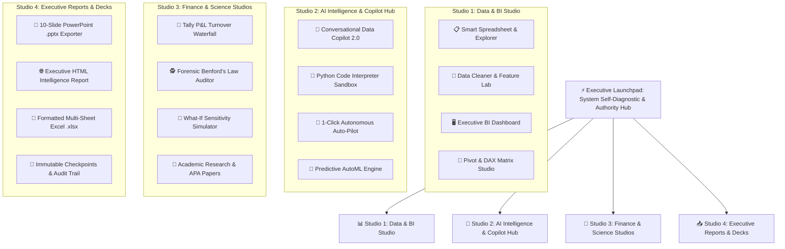

# ⚡ Autonomous DA Enterprise — Intelligent No-Code Analytics & Decision Platform

[](https://anmol-autonomous-da.streamlit.app)
[](https://python.org)
[-emerald.svg)](https://github.com/anmolgupta266650/Autonomous-DA)
[](https://opensource.org/licenses/MIT)
[](https://github.com/anmolgupta266650/Autonomous-DA)

> **Live Production Deployment**: 👉 **[https://anmol-autonomous-da.streamlit.app](https://anmol-autonomous-da.streamlit.app)**  
> **Official Demonstration Account**: `admin` / `admin123` *(Pre-seeded with Full Platform Role-Based Access Control)*

---

## 📌 Executive Summary & Abstract

Modern organizations face steep technical friction when attempting to derive rapid commercial insights, clean noisy multi-source data, build executive dashboards, run forensic audits, and train machine learning models without writing complex code.

**Autonomous DA** is a full-stack, enterprise-grade, no-code data analytics and business intelligence platform. It consolidates the analytical capabilities of:
* **Microsoft Excel & Power BI** (smart in-browser grid editing, multi-level hierarchical pivot matrices, and Power BI DAX-style measures).
* **Tally Prime & Corporate Financial Accounting** (P&L turnover waterfall flows, accounts receivable debtor aging, and forensic Benford's Law auditing).
* **Scientific Research Platforms** (autonomous hypothesis formulation $H_0/H_1$, Welch's t-tests, One-Way ANOVA, OLS regressions, and 1-click **APA 7th Edition manuscript drafting**).
* **Generative AI & AutoML Systems** (Conversational AI Copilot 2.0 with isolated Python Code Interpreter sandbox, 1-Click Autonomous Auto-Pilot audits, and automated classification/regression model benchmarking).
* **Executive Presentation Deliverables** (1-Click **10-Slide Microsoft PowerPoint `.pptx` presentation deck synthesis**, standalone HTML briefings, and formatted Excel exports).

---

## 🏛️ Platform Architecture: The 4 Consolidated Flagship Studios

To deliver a clutter-free, high-productivity user experience, **Autonomous DA** consolidates 11 specialized analytical tools into **4 flagship integrated workspaces**:



---

## 🚀 Flagship Studios Breakdown

| Flagship Studio | Core Analytical Capabilities | Integrated Deliverables |
| :--- | :--- | :--- |
| **📊 1. Data & BI Studio** | In-browser editable data grid, automated missing value imputation (median/mean/mode), duplicate elimination, Z-score outlier clamping, 4-grid cross-visual dashboards, and hierarchical pivot matrices. | Interactive Data Grid, Custom Plotly Charts, Dynamic DAX Measures (% Contribution, Cumulative YTD, Rolling Avg), Pivot `.csv` download. |
| **🤖 2. AI Intelligence Hub** | Plain-English conversational Copilot with 10 analytical intent handlers (outliers, trends, distributions), isolated Python Code Interpreter sandbox, 1-Click Autonomous Audit, and AutoML pipelines. | Real-time console execution, automated domain tagging, 5-fold cross-validated model leaderboard, and feature importance rankings. |
| **💼 3. Finance & Science Studios** | Corporate P&L statements, debtor aging buckets (0-30, 31-60, 61-90, 90+ days), forensic Benford's Law Chi-Square distribution check, duplicate voucher alerts, and What-If financial waterfall sensitivity forecasting. | Welch's two-sample t-test ($p$-value, Cohen's $d$), One-Way ANOVA, OLS econometric regression, and **1-Click APA 7th Edition paper generator**. |
| **📥 4. Executive Reports & Decks** | 1-Click synthesis of executive presentation slide decks, standalone intelligence briefings, styled Excel sheets, and audit trail rollback checkpoints. | **10-Slide native Microsoft PowerPoint (`.pptx`) widescreen presentation deck**, standalone HTML briefing (printable to PDF via `Ctrl+P`), `.xlsx`, and `.csv`. |

---

## 🧪 Built-in Enterprise Benchmark & Module Test Presets

The platform comes pre-seeded with **6 authentic benchmark datasets** and dedicated **1-click module test presets** so evaluators and senior authorities can test every function immediately with zero setup:

| Test Preset | Dedicated Dataset | Primary Target Attributes | What Authorities Verify |
| :--- | :--- | :--- | :--- |
| **💼 Tally Corporate Finance** | `SME Accounting & Ledger` (1,000 txns) | `Credit_Amount`, `Debit_Amount`, `Party_Name` | P&L Waterfall, Debtor Aging, Benford's Law Chi-Square, Duplicate Payment Detection, What-If Simulation. |
| **🔬 Academic Research** | `College Admissions` (1,200 applicants) | `Admission_Status`, `High_School_GPA`, `SAT_Score` | Auto-Generated Hypotheses ($H_0/H_1$), Welch's t-test, ANOVA, OLS Regression, APA 7th Edition Paper. |
| **🖥️ Power BI & Pivot** | `Global Superstore Sales` (1,200 txns) | `Region`, `Product_Category`, `Sales_Amount` | Executive KPI Cards, Multi-level Pivot Matrix with Totals, DAX Running Total & % Contribution. |
| **🤖 AutoML (Classification)** | `IBM Telco Customer Churn` (1,200 rows) | Target: `Churn` | Auto Task Inference, 5-Fold CV Model Leaderboard (Logistic Reg, RF, Gradient Boosting), ROC-AUC Scores. |
| **🏡 AutoML (Regression)** | `California Housing Economics` (1,500 rows) | Target: `MedHouseVal` | Model Comparison (Ridge, Decision Tree, Random Forest, Gradient Boosting), $R^2$ Variance, RMSE, MAE. |
| **🧹 Data Cleaning Sentinel** | `Dirty Benchmark` (515 rows) | `Annual_Salary`, `Department` | 35 Missing NaNs, 15 Duplicates, 8 Extreme Outlier Spikes (450k-990k). Verifies automated cleaning. |
| **💬 AI Copilot 2.0** | `Global Superstore Sales` (1,200 txns) | Conversational queries | Outlier detection, monthly revenue trend analysis, isolated Python Code Interpreter execution. |
| **📥 Executive Exporter** | `Global Superstore Sales` (1,200 txns) | Enterprise dataset | **1-Click 10-Slide Microsoft PowerPoint (`.pptx`) slide deck generation**. |

---

## 🔐 Enterprise Role-Based Access Control (RBAC)

The platform enforces secure authentication using **salted SHA-256 password hashing** and persistent SQLite session state management:

| Pre-Seeded Username | Password | Authorized Role | Granted Studio Permissions |
| :--- | :--- | :--- | :--- |
| `admin` | `admin123` | **👑 Administrator** | Full platform access across all 4 Flagship Studios, user management, and database stages. |
| `cfo_accountant` | `tally123` | **💼 CFO / Accountant** | Specialized access to Tally Financial Statements, Forensic Audits, What-If Simulators, and Reports. |
| `researcher` | `science123` | **🔬 Research Scientist** | Specialized access to Academic Research Studio, Hypothesis Engines, APA Paper Generator, and AutoML. |
| `executive` | `exec123` | **📊 Executive Viewer** | Access to Executive BI Dashboards, Pivot Matrices, and 16:9 Presentation Slide Decks. |

---

## 🧪 Automated Verification & Testing Suite

The application includes an exhaustive automated verification test runner (`scratch/test_exhaustive.py`) covering **13 deep test suites across all 18 backend modules, 6 enterprise datasets, and adversarial edge cases**:

```bash
$ python scratch/test_exhaustive.py

✅ PASS: Database & RBAC (Auth, Users, Checkpoints, Papers)
✅ PASS: Template Generator (Tally Ledger, Sales BI, Academic Survey)
✅ PASS: Benchmark Dataset: 💼 SME Accounting & Ledger (Tally-Style) (1000 rows)
✅ PASS: Benchmark Dataset: 🎓 College Students & Admissions (1,200 applicants) (1200 rows)
✅ PASS: Benchmark Dataset: 🛒 Global Superstore Sales (1,200 transactions) (1200 rows)
✅ PASS: Benchmark Dataset: 📡 IBM Telco Customer Churn (1,200 subscribers) (1200 rows)
✅ PASS: Benchmark Dataset: 🏡 California Housing Economics (1,500 Census records) (1500 rows)
✅ PASS: Benchmark Dataset: 🔬 Healthcare Clinical Diagnostics (569 biopsy records) (569 rows)
✅ PASS: Data Cleaner (All 7 operations)
✅ PASS: Feature Builder (Math, Transform, Dates, Bins, Flags)
✅ PASS: EDA Profiler, BI Visualizer & Business Insights
✅ PASS: Research Studio (Questions, Welch t-test, ANOVA, OLS, APA 7th Paper)
✅ PASS: Tally Finance & Forensic Auditor (Benford's Law, Duplicates, Aging)
✅ PASS: Power BI Studio (Pivot Table, DAX Measures, Heatmap Matrix)
✅ PASS: AutoML Engine (Classification & Regression Pipelines)
✅ PASS: Reports, 16:9 Presentation Decks, PPTX & Copilot Code Interpreter
✅ PASS: Adversarial Edge Cases (Empty, 1-Row, Zero-Variance, High-NaN)
✅ PASS: Authority Testing Hub & Module Test Presets (8/8 Engines Verified)

============================================================
🎯 ALL 13 DEEP TEST SUITES & ALL MODULES PASSED WITH 0 ERRORS!
============================================================
```

---

## 💻 Local Installation & Setup

### Prerequisites
* Python 3.10+ (Recommended: Python 3.12)
* Git

### Step-by-Step Instructions
```bash
# 1. Clone the repository
git clone https://github.com/anmolgupta266650/Autonomous-DA.git
cd Autonomous-DA

# 2. Create and activate a virtual environment
python -m venv .venv
# On Windows:
.\.venv\Scripts\activate
# On macOS/Linux:
source .venv/bin/activate

# 3. Install dependencies
pip install -r requirements.txt

# 4. Launch the application
streamlit run app.py
```
Open **`http://localhost:8501`** in your browser.

---

## 🐳 Docker Deployment

The application includes an optimized, non-root multi-stage Docker container:

```bash
# Build the Docker image
docker build -t autonomous-da:latest .

# Run the container
docker run -d -p 8501:8501 --name autonomous-da-app autonomous-da:latest
```
Access the application at `http://localhost:8501`.

---

## 📄 License
This project is licensed under the **MIT License** — see the [LICENSE](LICENSE) file for details.
