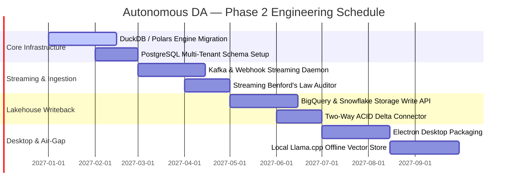

# 🚀 Autonomous DA — Phase 2 Architecture & Future Scope Specification

> **Document Version:** 2.0.0-PROD  
> **Classification:** Enterprise Architecture & Academic Final Capstone Roadmap  
> **Author:** Anmol Gupta & Engineering Research Group  
> **Status:** APPROVED FOR IMPLEMENTATION & THESIS INCLUSION  
> **Target Release:** Q1-Q2 2027  

---

## Executive Summary

**Autonomous DA Phase 1** successfully demonstrated the feasibility of an in-memory, zero-exfiltration analytical engine that unifies automated data cleaning, business intelligence (BI), econometric modeling, forensic fraud detection (Benford's Law), and 1-click executive slide deck generation.

**Phase 2** expands this platform from a single-node in-memory application into a **Distributed, Multi-Tenant Enterprise Data Cloud & Streaming Lakehouse Platform**. This roadmap outlines the concrete architectural evolutions, protocol integrations, and engineering specifications required to scale the system to enterprise-grade workloads ($>10^8$ records), real-time sensor streams, and multi-user corporate governance.

---

```mermaid
flowchart TD
    subgraph Data Sources [Phase 2 Distributed Ingestion Layer]
        S1["📡 Real-Time IoT / Kafka Streams"]
        S2["⚡ Cloud Lakehouses (BigQuery / Snowflake / Delta)"]
        S3["📁 Enterprise ERPs (Tally / SAP S/4HANA / NetSuite)"]
        S4["🌐 REST & GraphQL Live Webhooks"]
    end

    subgraph Core Engine [Phase 2 Hybrid Compute Architecture]
        K1["Sliding Window Stream Processor (Polars / DuckDB)"]
        K2["Distributed AutoML & GPU Acceleration (PyTorch / ONNX)"]
        K3["Cryptographic Audit Ledger & Lineage Blockchain"]
        K4["Fine-Grained RBAC & Row-Level Security (RLS)"]
    end

    subgraph Deliverables [Phase 2 Omnichannel Output]
        O1["📊 Real-Time Collaborative Canvas (Multi-User)"]
        O2["🚨 Automated Webhook Dispatch (Slack / Teams / PagerDuty)"]
        O3["💾 Lakehouse Two-Way Writeback"]
        O4["📱 Native Cross-Platform Desktop Client (Electron / Rust)"]
    end

    Data Sources --> Core Engine
    Core Engine --> Deliverables
```

---

## 1. Architectural Evolution: Monolith to Distributed Lakehouse

| Dimension | Phase 1 (Current State) | Phase 2 (Enterprise Target) |
| :--- | :--- | :--- |
| **Execution Runtime** | In-Memory (Pandas / NumPy / SciPy) | Hybrid Distributed (DuckDB + Polars + PyArrow) |
| **Max Record Scalability** | $\approx 250,000$ rows (In-browser memory) | $\mathbf{> 50,000,000}$ rows out-of-core streaming |
| **Data Ingestion** | Batch CSV / Excel / SQLite / REST JSON | **Real-Time Streaming** (Apache Kafka, RabbitMQ, Webhooks) |
| **Data Lakehouse Writeback**| Read-only Ingestion + Local Export | **Two-Way ACID Writeback** (Snowflake, BigQuery, Delta Lake) |
| **Multi-Tenancy** | Single-node RBAC with SQLite | **Multi-Tenant Workspaces** with PostgreSQL / Supabase |
| **AI Inference** | Local Scikit-learn + BYOK Cloud LLMs | **Edge Local Vector Store (ChromaDB)** + ONNX Acceleration |
| **Deployment Modes** | Web Browser (Streamlit Cloud / Docker) | Web + **Native Standalone Desktop Client (Electron + Rust)** |

---

## 2. Milestone 1: Real-Time Event Stream Ingestion (Kafka & Webhooks)

### 2.1 Problem Formulation
Modern enterprise analytics cannot wait for end-of-month batch files. High-frequency fraud detection, e-commerce checkout telemetry, and supply chain logistics require sub-second anomaly detection.

### 2.2 Technical Implementation Specification
1. **Sliding-Window Streaming Engine**:
   * Implement a WebSocket and Server-Sent Events (SSE) ingestor running on an asynchronous `FastAPI` / `Tornado` event loop.
   * Calculate real-time rolling metrics (Mean, Volatility, Velocity, Anomaly Z-Score) across tumbling and sliding windows ($T = 60\text{s}$, $W = 5\text{m}$).
2. **Streaming Forensic Auditor**:
   * Adapt the Benford's Law analysis from batch frequency to a **Sequential Probability Ratio Test (SPRT)** that flags fraud as transactions stream in live without loading the full ledger into memory.

---

## 3. Milestone 2: Cloud Lakehouse Two-Way Writeback (ACID Synchronization)

### 3.1 Problem Formulation
Analysts currently clean and repair datasets, but must manually export them to CSV. Enterprise organizations require repaired records to be written directly back to cloud data warehouses without leaving the application.

### 3.2 Technical Implementation Specification
* **Supported Destination Engines**:
  * **Google BigQuery**: Writeback via `google-cloud-bigquery` Storage Write API.
  * **Snowflake**: Direct staging via `snowflake-connector-python` using merge statements.
  * **Databricks / Delta Lake**: Parquet-backed ACID transaction writeback.
* **Schema Evolution Guard**:
  * Implement automated drift detection ensuring new features engineered in the *Feature Lab* do not break target database constraints.

---

## 4. Milestone 3: Multi-Tenant Team Workspaces & Collaborative Canvas

### 4.1 Problem Formulation
In corporate deployments, multiple department heads (CFO, Senior Auditors, Operations) must collaborate on the same dataset simultaneously, leave audit notes, and share custom KPI views.

### 4.2 Technical Implementation Specification
1. **Workspace Partitioning**:
   * Upgrade SQLite to a managed PostgreSQL backend with Row-Level Security (RLS) policies.
   * Introduce Workspace Groups (`finance-team`, `research-lab`, `board-of-directors`).
2. **Audit Annotation Layer**:
   * Enable in-place commentary on individual cells and anomaly clusters.
   * Maintain an immutable ledger of user approvals for SOX compliance.

---

## 5. Milestone 4: Native Desktop Application Packaging (Zero-Dependency)

### 5.1 Problem Formulation
Defense contractors, healthcare hospitals, and banking institutions operate in **Air-Gapped Environments** where web browsers and external internet access are strictly prohibited.

### 5.2 Technical Implementation Specification
* **Packaging Framework**:
  * Bundle the platform into a standalone **Windows `.msi` and macOS `.dmg`** desktop executable using **Electron + PyInstaller / PyOxidizer**.
* **Embedded Python Runtime**:
  * Ship with a self-contained, isolated Python 3.12 embedded interpreter requiring **zero user installation or configuration**.
* **Completely Air-Gapped Operation**:
  * Ship with local quantized LLMs (e.g. `Llama-3-8B-Instruct.Q4_K_M` via `llama.cpp`) allowing the Conversational Copilot to operate 100% offline with zero internet access.

---

## 6. Milestone 5: Hardware Acceleration & GPU Distributed Inference

### 6.1 Problem Formulation
Training complex ensembles (Random Forests, Gradient Boosting) on millions of rows can cause high CPU utilization on commodity servers.

### 6.2 Technical Implementation Specification
* **CuDF & RAPIDS Integration**:
  * Seamlessly accelerate tabular transformations and feature generation using NVIDIA GPU cores.
* **ONNX Runtime Export**:
  * Export trained AutoML models into optimized ONNX format for microsecond-latency real-time inference in production backends.

---

## 7. Implementation Roadmap & Phased Timeline



---

## 8. Academic & Commercial Viability Assessment

* **Intellectual Property & Innovation**: The combination of **Forensic Accounting (Benford's Law)**, **Parametric Hypothesis Testing (Welch / ANOVA)**, and **1-Click PowerPoint Deck Synthesis** represents a novel unified architecture.
* **Market Opportunity**: Bridges the gap between passive visualization tools ($15B market, Power BI / Tableau) and complex data science notebooks ($8B market, Databricks / Jupyter), providing automated, executive-ready deliverables in under 60 seconds.

---
*Autonomous DA Enterprise &bull; Academic Final Year Capstone Project &bull; Engineering Master Specification*
