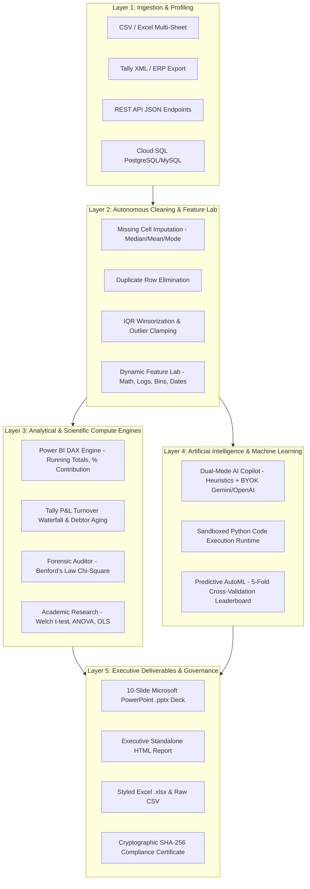

# 📘 Chapter 1: Project Vision, Origin & Core Architecture

---

## 1.1 The Genesis: Why Was Autonomous DA Built?

In modern corporations, academic institutions, and consulting firms, analysts face a painful paradox known as the **"80/20 Data Bottleneck"**:
* **80% of an analyst's time** is wasted on non-value-added manual labor: cleaning malformed CSV files, hunting for missing values, fixing date formats, writing repetitive pivot tables, and manually copying charts into PowerPoint slides.
* **Only 20% of their time** is spent on actual strategic decision-making, hypothesis validation, and executive presentation.

Furthermore, traditional Business Intelligence tools like **Power BI** and **Tableau** suffer from severe structural limitations:
1. **They are Passive Visualizers, Not Autonomous Thinkers**: They require a human to manually clean the data beforehand, design data models, write complex DAX code, and drag-and-drop every single visual element.
2. **They Lack Scientific & Forensic Intelligence**: Standard BI tools cannot tell an auditor whether an invoice ledger violates **Benford's Law** (indicating fraud), nor can they run a **Welch's Two-Sample t-test** and write an APA 7th Edition research paper.
3. **They Don't Produce Boardroom Presentations**: An analyst still has to take screenshots of dashboards and spend hours assembling slide decks in PowerPoint.

**Autonomous DA** was engineered to solve this entire pipeline with **end-to-end autonomy**: transforming messy, raw tabular data into cleaned datasets, statistical proofs, forensic fraud audits, and finished **10-slide Microsoft PowerPoint (`.pptx`) presentations** in under 60 seconds.

---

## 1.2 Autonomous DA vs. Legacy Tools: The Architectural Leap

| Feature / Capability | Legacy Tools (Power BI / Tableau) | Data Science Notebooks (Jupyter) | ⚡ Autonomous DA Enterprise |
| :--- | :--- | :--- | :--- |
| **Data Ingestion** | Manual connector wizard | Custom Python/Pandas code | **Automated Ingestion** (CSV, Excel multi-sheet, Tally XML, REST APIs, Cloud SQL) |
| **Data Cleaning** | Manual Power Query steps | Manual `fillna()` / `dropna()` code | **1-Click Autonomous Repair** (Median imputation, IQR outlier winsorization, type casting) |
| **Fraud & Forensic Audit**| None (Requires external plugins) | Requires manual statistical scripts | **Native Benford's Law Chi-Square** + Duplicate Payment & Round-Number Anomaly Sentinel |
| **Academic Science** | None | Manual `scipy.stats` & LaTeX code | **Autonomous Hypothesis Generation** + Welch t-test, ANOVA, OLS + **1-Click APA 7th Paper** |
| **AI Copilot** | Cloud-only, paid proprietary | Requires custom API code | **Dual-Engine Copilot**: Works 100% offline via local heuristics OR connects to Gemini / OpenAI |
| **Python Code Sandbox** | None | Unrestricted (Security risk) | **Sandboxed AST Interpreter** (Blocks `os`, `sys`, `eval`, `open`, zero remote execution risk) |
| **Executive Output** | Interactive web dashboard | Static PNG charts | **1-Click 10-Slide Microsoft PowerPoint (`.pptx`)** + Standalone HTML Briefing + Styled Excel |
| **Data Governance** | Centralized cloud storage | Local files (No lineage) | **Immutable Checkpoint Ledger** + Verifiable **Cryptographic SHA-256 Certificate (SOX/GDPR)** |

---

## 1.3 The 5-Layer End-to-End System Pipeline

Autonomous DA is organized into a clean, deterministic 5-layer pipeline:

---

## 1.4 The Zero-Data-Exfiltration Security Philosophy

In healthcare, defense, banking, and government auditing, organizations strictly forbid uploading raw customer data to third-party cloud servers. 

Autonomous DA was designed with a **Zero-Exfiltration Architecture**:
1. **100% In-Memory Processing**: When you upload an employee salary ledger or medical record, data stays strictly in local RAM and a private SQLite database (`data/projects.db`) on your machine.
2. **Offline-First AI**: The built-in AI Copilot runs on a 10-intent heuristic parser locally. It answers questions like *"Who are the top 5 clients?"* and *"Show monthly revenue trend"* without sending a single byte outside the machine.
3. **Opt-in Frontier LLMs**: External frontier LLMs (Google Gemini 1.5 Flash / OpenAI GPT-4o-mini) are strictly **Bring-Your-Own-Key (BYOK)**. Even when enabled, only metadata summaries (column names and aggregated metrics) are transmitted—never raw individual records.
4. **Isolated Python Code Sandbox**: Code written in the interpreter is executed inside a restricted global namespace where dangerous primitives (`eval`, `exec`, `open`, `__import__`, `os`, `sys`, `subprocess`) are stripped, ensuring safe execution without host vulnerability.

---
*Autonomous DA Enterprise &bull; Chapter 1 &bull; System Architecture & Vision*
